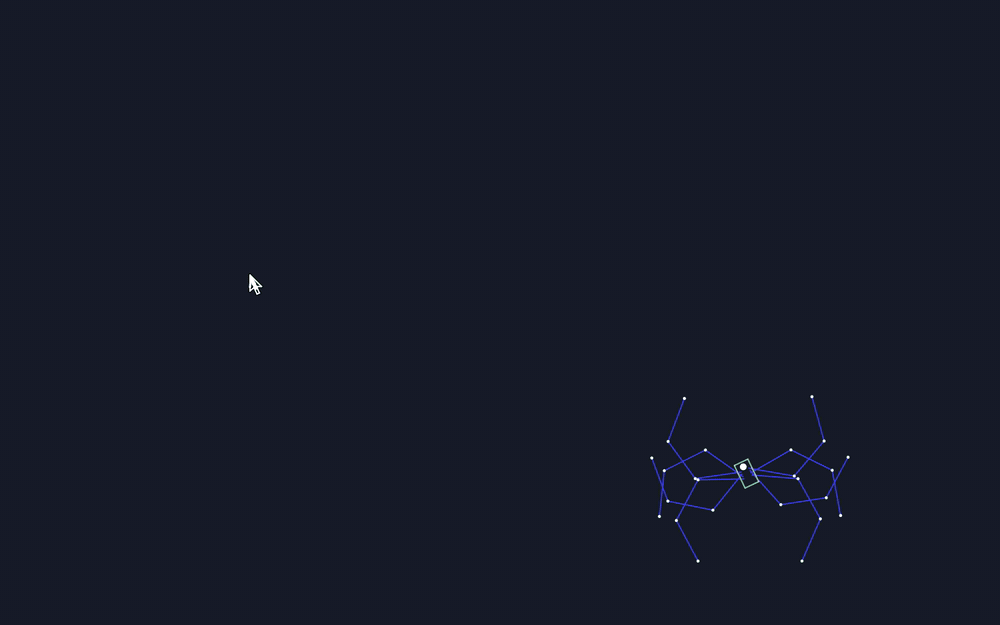
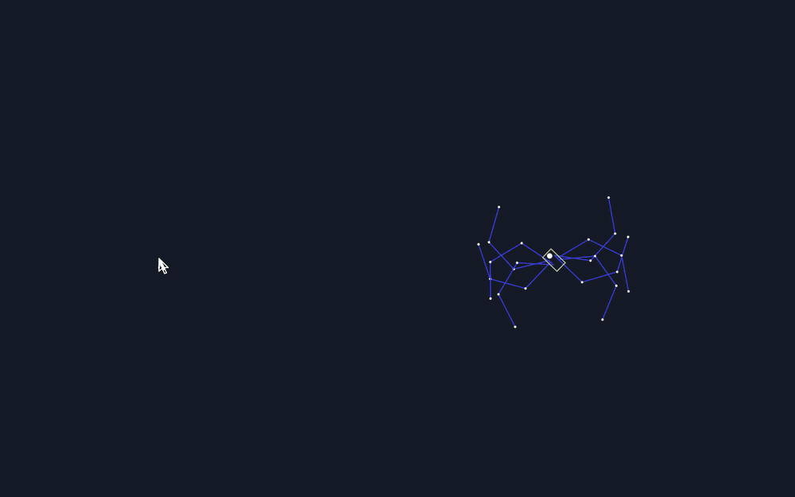
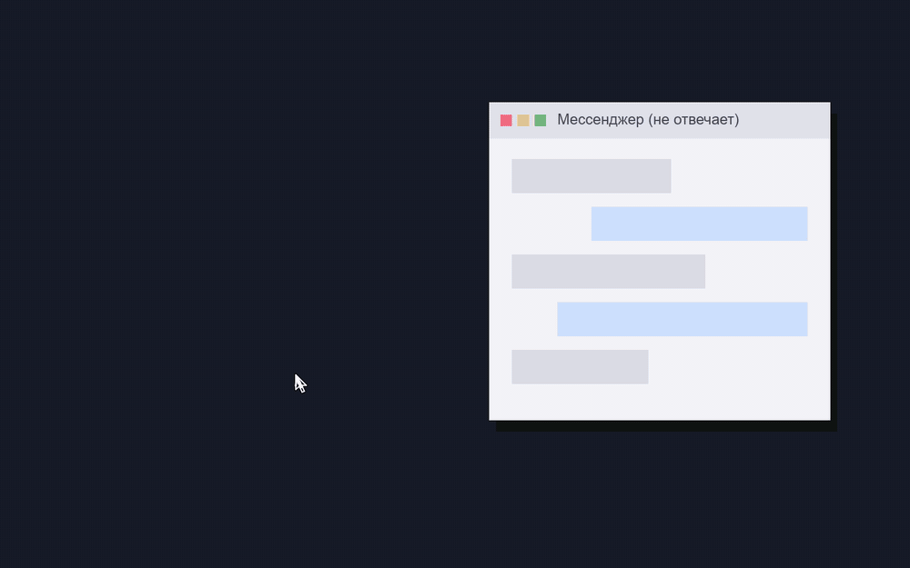

# Desktop Spider

Процедурный паук, который живёт поверх всех окон и бегает за курсором. А ещё плеть: зажали хоткей — курсор стал плетью, можно хлестнуть паука или зависший мессенджер.

Rust + wgpu, прозрачное окно поверх всего, клики проходят насквозь. macOS и Windows.

## Режимы

Переключаются в меню у иконки в меню-баре (macOS) / трее (Windows): **Режим → …**

### Паук

Паук бежит за курсором и останавливается рядом. Ноги — инверсная кинематика, переступают сами, попеременно.



### Игра: попади по пауку

Паук держит дистанцию и уворачивается от резких движений мыши. Зажмите хоткей и бейте: попадание оглушает паука, захлёст ловит и подтягивает к курсору. Счёт — у иконки в меню-баре.



### Просто плеть

Паука нет — бейте по чему угодно. На месте удара остаётся гаснущий след.



## Управление плетью

| | |
|---|---|
| Удерживать `⌃⌥` (Windows: `Ctrl+Alt`) | курсор становится плетью |
| ЛКМ | удар: замах, бросок, щелчок |
| ПКМ — держать | раскрутка, растёт заряд |
| ПКМ — отпустить | захлёст: ловит паука в досягаемости, иначе усиленный щелчок |

Пока хоткей зажат, клики достаются плети, а не окнам под ней. На macOS первый клик ненадолго делает активным приложение паука — фокус возвращается, когда отпускаете хоткей.

В меню **Плеть**: цвет (светлая / чёрная), размер (×0.7 – ×2), хоткей.

## Установка

Готовые сборки — на странице [релизов](https://github.com/whowho-agent/desktop_spider/releases):

- **macOS (Apple Silicon, 13+)** — `DesktopSpider-macos-arm64.zip`, перенесите `DesktopSpider.app` в «Программы». Сборка без подписи разработчика: при первом запуске правый клик → «Открыть», или
  `/usr/bin/xattr -dr com.apple.quarantine /Applications/DesktopSpider.app`.
- **Windows 10/11 (x64)** — `DesktopSpider-windows-x64.zip`, распакуйте и запустите `desktop_spider.exe` (из архива не запускайте — рядом должна лежать папка `presets`). SmartScreen может предупредить о неизвестном издателе: «Подробнее» → «Выполнить в любом случае».

Системные разрешения не нужны.

## Настройка

**`config.toml`** — режим, плеть, пресет; меню пишет сюда само.
macOS: `~/Library/Application Support/DesktopSpider/config.toml`, Windows: `%APPDATA%\DesktopSpider\config.toml`.

```toml
mode = "game"          # spider | game | whip
whip_skin = "black"    # light | black
whip_size = 1.4        # 0.5 – 3
whip_hotkey = "ctrl+alt"   # модификаторы ctrl/alt/shift/cmd (+ клавиша, например "ctrl+alt+w")
preset = "spider"
```

**Пресеты паука** — `presets/*.toml` (в `.app` — `Contents/Resources/presets`): цвета, длины ног, число пар, стиль (`straight` / `curve` / `dotted`), скорость, походка. Правки подхватываются на лету. В комплекте: `spider`, `blue3`, `tentacle`, `harvestman`, `octopus`. Эталон со всеми полями и комментариями — [`presets/spider.toml`](presets/spider.toml).

## Сборка из исходников

```bash
cargo run --release
```

Переменные окружения: `SPIDER_PRESET=tentacle` — стартовый пресет, `SPIDER_DEBUG=1` — отладочная отрисовка, `SPIDER_INPUT_DEBUG=1` — лог хоткея и захвата мыши.

`.app` для macOS: `scripts/bundle.sh`. Гифки для этого README: `scripts/gifs.sh` — приложение само рендерит сцены без окна (`--record`), ffmpeg собирает GIF.

## Как устроено

- `src/sim` — паук: тело с рулением к цели, ноги (аналитический IK для 2 сегментов, FABRIK для 3+), походка, реакции в игре.
- `src/whip` — плеть: Verlet-цепочка хлыста, анимация рукояти, щелчок и захлёст, эффекты.
- `src/render` — wgpu, один инстансный шейдер (WGSL) рисует сглаженные отрезки, точки и кольца.
- `src/platform` — прозрачное окно поверх всего, курсор, хоткей, захват мыши (macOS / Windows).
- `src/world.rs` — общий для приложения и записи гифок мир: режим, паук, плеть, счёт.

Подробности и история решений — в [`PLAN.md`](PLAN.md), эскиз плети — [`design/whip_demo.html`](design/whip_demo.html).
